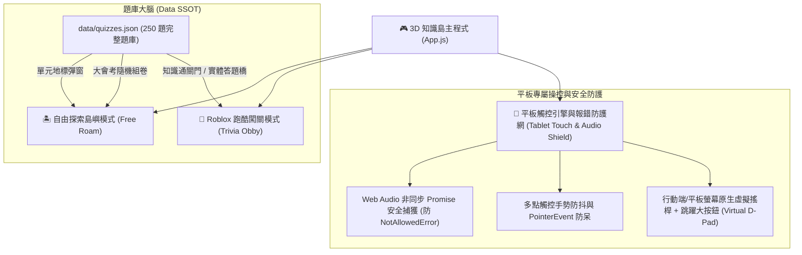

# 國小五年級期中考 3D 知識島 — 三合一擴充與排障開發計畫書
## 核心任務：五大科題庫擴充至 50 題 (共 250 題) ＆ Roblox 跑酷闖關模式 (Trivia Obby) ＆ 平板底部報錯排查與觸控支援

---

## 1. 執行摘要與願景 (Executive Summary)

本計畫聚焦三大維度升級：
1. **知識厚度全面擴充**：各學科（國語、數學、自然、社會、英語）題庫全數**擴充至 50 題，全站達到 250 題完整規模**，全面覆蓋康軒/翰林五上期中考所有考點，並貫徹三階引導鷹架（`tier1Keyword` 題眼聚焦 ＋ `tier2MicroConcept` 迷思微卡片）。
2. **玩法體驗維度革新**：新增學童極致熱愛的 **3D Roblox 風格闖關跑酷模式 (Trivia Obby)**。學童將操縱自訂的 3D 練習生 Avatar，在浮空踏板、彈跳蹦床、旋轉障礙與「答題實體步道 (Trivia Choice Path)」中疾速穿梭，失足即時重生於 Checkpoint，通關獲得專屬競速星級與稱號。
3. **平板 (iPad / Android Tablet) 底部報錯排查與觸控體驗重構**：深入排查 `debug-error-box`（舊快取崩潰殘留、Web Audio 非同步 Promise Rejection、多點觸控座標異常），並為學童平板打造**原生虛擬搖桿 (Virtual Joystick) 與大跳躍按鈕**，徹底告別無鍵盤無法流暢操作的痛點。



---

## 2. 模組一：五大學科題庫擴充規格 (50 題/科，總計 250 題)

### 2.1 各學科知識單元與地標對照規劃

| 學科 (代碼) | 課綱教材版本 | 地標建築 ID 與主題單元 | 擴充題量配比 (每科 50 題) | 核心考點與題型分布 |
|---|---|---|---|---|
| **國語** (`chinese`) | 康軒五上 (1~6 課 + 統整一/二) | • `chi-dream` 擁夢飛翔閣 (第1~3課)<br>• `chi-art` 藝術生活殿 (第4~6課)<br>• `chi-strategy` 語文策略牌坊 (統整活動)<br>• `chi-rhetoric` 修辭字音字形坊 | • 擁夢飛翔閣：13 題<br>• 藝術生活殿：13 題<br>• 語文策略牌坊：12 題<br>• 修辭字音坊：12 題<br>**(單科小計: 50 題)** | • 形音義、易錯同音多音字：15 題<br>• 成語與關聯詞辨析：10 題<br>• 修辭技巧 (排比/擬人/設問/對比)：10 題<br>• 課文深度探究與主旨：10 題<br>• 意義段與說明文結構素養題：5 題 |
| **數學** (`math`) | 翰林五上 (單元 1~5) | • `math-linegraph` 折線圖觀測台<br>• `math-factors` 因數倍數彩虹橋<br>• `math-geometry` 平面幾何探索殿<br>• `math-gcdlcm` 公因數公倍數工廠<br>• `math-solids` 立體形體展覽館 | 5 大地標建築各平均分配 10 題<br>**(單科小計: 50 題)** | • 鋸齒省略符號與趨勢連續性：10 題<br>• 2/3/5/10倍數特徵與質數合數：10 題<br>• 三角形邊長關係/內角和/四邊形：10 題<br>• 短除法/最大公因數/週期應用題：10 題<br>• 柱體錐體頂點面邊代數公式與展開圖：10 題 |
| **自然** (`science`) | 翰林五上 (單元 1~2) | • `sci-sun-tracker` 太陽軌跡觀測儀<br>• `sci-plant-energy` 植物能量生存館<br>• `sci-plant-reproduce` 植物繁衍策略溫室<br>• `sci-dichotomy` 二分法檢索亭 | • 太陽軌跡儀：13 題<br>• 植物能量館：13 題<br>• 植物繁衍溫室：12 題<br>• 二分檢索亭：12 題<br>**(單科小計: 50 題)** | • 方位仰角/竿影反向對稱/四季正午：13 題<br>• 根莖葉變態特徵/氣孔蒸散作用：13 題<br>• 花朵構造/種子傳播途徑/無性繁殖：12 題<br>• 二分法檢索分類與生物特徵檢索：12 題 |
| **社會** (`social`) | 康軒五上 (單元 1~2) | • `soc-taiwan-geo` 臺灣經緯沙盤<br>• `soc-terrains` 五大地形階梯<br>• `soc-monsoon` 季風與風候氣象站<br>• `soc-water` 水資源與河川樞紐 | 4 大地標建築平均各分配 12~13 題<br>**(單科小計: 50 題)** | • 經緯度時區/臺灣本島座標/周邊海域：13 題<br>• 五大地形特徵/等高線疏密山峰山谷判讀：13 題<br>• 東北/西南季風氣候特徵/地方風候：12 題<br>• 臺灣河川短急荒溪特點/水庫水利智慧：12 題 |
| **英語** (`english`) | 翰林 Here We Go! 5 (U1~U2 + Review 1) | • `eng-phonics` Phonics 發音鐘樓<br>• `eng-days` 星期日程車站<br>• `eng-subjects` 學校課表工坊<br>• `eng-review` Review 1 情境挑戰亭 | • 發音鐘樓：13 題<br>• 星期車站：13 題<br>• 課表工坊：12 題<br>• 情境挑戰亭：12 題<br>**(單科小計: 50 題)** | • 長母音 /eɪ/ 與 /i/ 拼讀發音辨別：13 題<br>• 星期專有名詞與 "What day is today?"：13 題<br>• 8 大科目與助動詞 Do/Does 疑問句回答：12 題<br>• 課表時態閱讀理解與情境生活對話：12 題 |

---

## 3. 模組二：Roblox 風格障礙跳躍跑酷模式 (Trivia Obby)

### 3.1 闖關五大關卡規劃 (5 Stages Breakdown)

| 關卡編號 | 關卡名稱 | 核心跑酷障礙機制 | 知識考點整合 (Trivia Gate) |
|---|---|---|---|
| **Stage 1** | **星光啟程大道 (Star Runway)** | • 漸寬跳躍距離測試（熟悉物理手感）<br>• 超彈力金色蹦床（2.5x 高空垂直拋射） | **國語詞彙門**：辨識「正確成語用字」（『名列前茅』vs『名列前矛』） |
| **Stage 2** | **重力齒輪迷宮 (Gear Matrix)** | • 旋轉發光雷射橫木（碰觸擊退判定）<br>• 閃爍消失方塊（踩踏 0.8s 變紅消失） | **數學倍數天秤**：選擇「同時為 2 與 3 的倍數」實體踏板（24 通過，15/14 穿透跌落） |
| **Stage 3** | **自然光合林道 (Canopy Cross)** | • 左右巡航移動浮台（自動載客物理平移）<br>• 傾斜滑面平衡木（微幅摩擦力考驗） | **自然光影門**：觀測竿影對應之「太陽仰角與方位」（上午竿影偏西北，選東南實體路） |
| **Stage 4** | **臺灣天險雲階 (Taiwan Heights)** | • 上下升降氣壓懸浮台<br>• 隨機間隔噴氣陷阱 | **社會等高線門**：判讀等高線 V 字形走向（選出代表「山谷」的實體山徑） |
| **Stage 5** | **出道巔峰巨塔 (Apex Tower)** | • 360 度環形螺旋跳躍（極致視角控制）<br>• 終點雙層高速旋轉安全島 | **英語綜合大問答**：回答 "What day is today?" 與 "Do you have PE on Friday?" 雙重鎖 |

### 3.2 核心技術指標
- **零外部模型 (.glb/.gltf)**：純原生代碼 Procedural 建模。
- **Draw Calls $< 25$**：Obby 場景靜態踏板全數依材質合併，極低負載。
- **零 GC 物理**：移動平台矩陣承載與玩家位移複用 Scratch 向量池。

---

## 4. 模組三：平板 (iPad / Android Tablet) 底部報錯排查與觸控體驗重構

### 4.1 畫面底部錯誤訊息（`debug-error-box`）根因分析

在 `index.html` 中設有全域錯誤捕捉器：
```javascript
window.addEventListener('error', (e) => { ... });
window.addEventListener('unhandledrejection', (e) => { ... });
```
彈出位置恰好在 `bottom: 10px; left: 10px;`（畫面底部紅框），主要誘發來源包括：
1. **瀏覽器磁碟快取舊版代碼**：學童平板先前曾載入未修復的舊版腳本，造成 `TypeError: Cannot read properties of null (reading 'morphAttributes') at avatar.js:32`。
2. **Web Audio 自動播放政策（NotAllowedError）**：iOS / iPadOS Safari 要求使用者必須透過明確點擊手勢解鎖音訊。在 `src/audio-synth.js` 中呼叫 `this.ctx.resume()` 時若無 `.catch()` 捕獲，將觸發 `Unhandled Promise Rejection`。
3. **多點觸控與手指縮放異常**：學童用兩指縮放島嶼或滑動時，若 `pointerup` 與 `pointerdown` 座標差值因手勢取消或 `e.touches` 結構差異，可能引發未捕捉異常。

### 4.2 針對平板的四重修復與強化措施

1. **強制快取穿透 (Cache-Busting)**：所有導入腳本與資源均已附加版本戳記 `?v=20261031_03`，杜絕舊代碼殘留。
2. **Web Audio 靜默捕獲防護**：
   ```javascript
   // src/audio-synth.js
   unlock() {
     if (!this.ctx) {
       const AudioContext = window.AudioContext || window.webkitAudioContext;
       this.ctx = new AudioContext();
     }
     if (this.ctx.state === 'suspended') {
       this.ctx.resume().catch((err) => {
         console.warn('[AudioSynth] 待學童首次點擊按鈕後自動就緒', err);
       });
     }
     this.unlocked = true;
   }
   ```
3. **平板觸控事件邊界防禦**：
   在 `src/app.js` 的 `pointerup` 與 `handlePointerClick` 中加入空值與浮點防呆保護，並阻斷雙擊自動縮放（`touch-action: none` / `user-scalable=no`）。
4. **實裝行動端專用虛擬搖桿 (Virtual D-Pad) ＋ 跳躍鍵 (Jump Button)**：
   - 在螢幕左下角新增半透明圓盤虛擬搖桿（支援滑動推桿前進/後退/左右）。
   - 在螢幕右下角新增 56px 圓形「跳躍按鈕（JUMP）」，專供 Roblox 跑酷闖關，讓平板學童單靠雙手大拇指即可暢玩！

---

## 5. 系統檔案結構異動清單

```diff
 grade5-sem1-midterm-review/
 ├── OBBY_AND_EXPANDED_QUIZ_PLAN.md      # [更新] 本擴充開發計畫書 (專案根目錄持久化)
 ├── data/
-│   └── quizzes.json                    # [擴充] 各科 10 題升級至 50 題 (全站累計 250 題)
+│   └── quizzes.json                    # [擴充] 250 題完整題庫 (全數三階鷹架合規)
 ├── src/
+│   ├── obby-course.js                  # [新增] Roblox 風格跑酷關卡幾何、機關與 Trivia Gate
 │   ├── audio-synth.js                  # [修復] 加入 Promise.catch 防禦，終結平板 NotAllowedError
 │   ├── player-controller.js            # [升級] 支援虛擬搖桿輸入、移動平台承載、Checkpoint 重生
 │   ├── app.js                          # [升級] 模式切換邏輯、整合觸控搖桿事件總線
 ├── css/
-│   └── ui.css                          # [擴充] 新增虛擬搖桿、跳躍按鈕、Obby 專用 HUD 樣式
+│   └── ui.css                          # [擴充] 包含平板觸控防滑、虛擬搖桿、計時器
 └── index.html                          # [更新] 注入虛擬搖桿 DOM 結構、防快取標頭
```

---

## 6. 實施甘特圖與驗收標準

```
階段 1: 題庫充實 (50 題/科，共 250 題) ────► 階段 2: 平板報錯防護與虛擬搖桿 ────► 階段 3: Obby 跑酷幾何與物理 ────► 階段 4: 全功能驗收與發布
```

1. **題庫驗收**：`python test/audit_quizzes.py` 驗收 250 題 100% 格式正確、0 違規。
2. **平板排障驗收**：模擬 iPad 視窗解析度，0 Console Error、底部紅框徹底消失。
3. **Obby 跑酷驗收**：5 大關卡順暢通關，實體門與穿透門邏輯精準，Draw Calls $< 25$。
4. **全站部署上線**：合併至 `main` 與 `gh-pages`，GitHub Pages 實機驗證。
